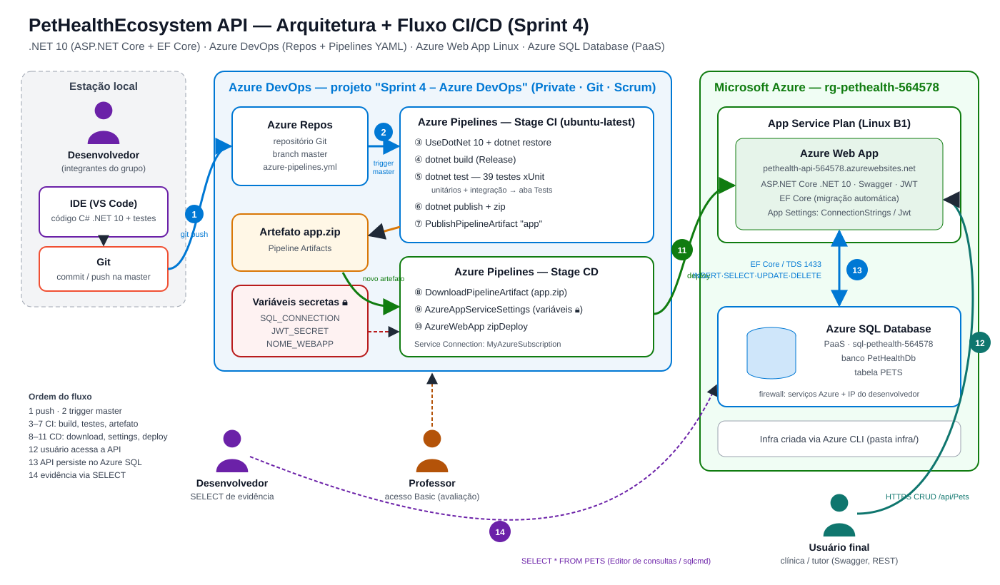

# PetHealthEcosystem API — Sprint 4 · DevOps Tools & Cloud Computing

[](https://dotnet.microsoft.com/)
[-0078d4.svg)](https://azure.microsoft.com/products/azure-sql/database)
[](azure-pipelines.yml)
[](#6-testes-automáticos)

> **Disciplina:** DevOps Tools & Cloud Computing — Entrega da 4ª Sprint
> **Solução baseada em:** Advanced Business Development with .NET
> **Turma:** 2TDSPV

### 👥 Integrantes do Grupo

| Nome | RM | Turma |
| :--- | :---: | :---: |
| **Gabriel Costa Solano** | 562325 | 2TDSPV |
| **Leandro Guarido** | 561760 | 2TDSPV |
| **Kaiky Pereira Rodrigues** | 564578 | 2TDSPV |

---

## 1. Descrição da solução

A **PetHealthEcosystem API** é o back-end do ecossistema de saúde animal da clínica: cadastra os **pets** atendidos (nome, raça, idade, tutor e se precisam de **cuidados pós-operatórios**), permite consultas com paginação, ordenação e filtros (por raça, tutor e pós-operatório), expõe links **HATEOAS** e protege as operações de escrita com **JWT** e perfis (Admin, Veterinário, Tutor). Cada alteração de cadastro também gera um registro de prontuário/auditoria clínica.

Nesta Sprint a API foi levada para a nuvem com **CI/CD no Azure DevOps**: todo commit na branch `master` compila, executa os testes automáticos, publica o artefato e faz o deploy no **Azure Web App**, com os dados persistidos em um **Azure SQL Database (PaaS)**.

### Stack de tecnologias

| Camada | Tecnologia |
| :--- | :--- |
| Linguagem / Framework | C# · ASP.NET Core **.NET 10** (Controllers, Swagger/OpenAPI) |
| Persistência | **Entity Framework Core 10** (SQL Server provider, migrações automáticas) |
| Banco de dados em nuvem | **Azure SQL Database** (PaaS) — tabela `PETS` |
| Segurança | JWT Bearer + RBAC (Admin / Veterinario / Tutor) |
| Observabilidade | Serilog, OpenTelemetry, Health Checks (`/health`) |
| Testes | xUnit, Moq, FluentAssertions, `WebApplicationFactory` (39 testes) |
| Versionamento | Git · **Azure Repos** |
| CI/CD | **Azure Pipelines** (YAML) — stages CI e CD |
| Hospedagem | **Azure App Service (Web App Linux, B1)** |
| Infraestrutura | Azure CLI (scripts em [`infra/`](infra)) |

---

## 2. Diagrama da Arquitetura + Fluxo CI/CD



**Ordem do fluxo (números do desenho):**

1. **Desenvolvedor** altera o código na IDE e faz `git push` na branch `master` do **Azure Repos**.
2. O push dispara automaticamente o **trigger** da pipeline (`trigger: master`).
3. **CI** — instala o .NET 10 e restaura as dependências.
4. **CI** — `dotnet build` em Release.
5. **CI** — `dotnet test`: 39 testes (unitários + integração do CRUD), resultados publicados na aba **Tests**.
6. **CI** — `dotnet publish` + compactação (`app.zip`).
7. **CI** — `PublishPipelineArtifact`: artefato **app** publicado no Azure DevOps.
8. **CD** — disparado após o novo artefato; baixa o `app.zip`.
9. **CD** — `AzureAppServiceSettings` grava as variáveis de ambiente (vindas das **variáveis secretas** 🔒).
10. **CD** — `AzureWebApp` faz o *zip deploy*.
11. A nova versão fica no ar no **Azure Web App**.
12. O **usuário final** acessa a API (Swagger/REST) via HTTPS.
13. A API persiste os dados no **Azure SQL Database** (EF Core).
14. O desenvolvedor comprova cada operação com `SELECT` no banco.

---

## 3. Banco de Dados em Nuvem

**Azure SQL Database (PaaS)** — opção aceita na lista da Sprint.

| Item | Valor |
| :--- | :--- |
| Servidor | `sql-pethealth-db-564578.database.windows.net` |
| Banco | `PetHealthDb` (Basic) — região Central US (East US não aceita novos servidores Azure SQL na assinatura Students) |
| Tabela | `PETS` (criada pela migração `InitialCreate` do EF Core quando a API sobe) |
| Acesso | Firewall: serviços do Azure (Web App) + IP do desenvolvedor |

Consultas de evidência: [`script.sql`](script.sql) — rodar no **Portal do Azure > Banco SQL > Editor de consultas** ou com `./infra/04_consultar-banco.sh`.

---

## 4. Projeto no Azure DevOps

| Campo | Valor |
| :--- | :--- |
| Project Name | **Sprint 4 – Azure DevOps** |
| Description | Projeto para entrega da Sprint 4 do professor João Menk<br>RM562325 - Gabriel Costa Solano - 2TDSPV<br>RM561760 - Leandro Guarido - 2TDSPV<br>RM564578 - Kaiky Pereira Rodrigues - 2TDSPV |
| Visibility | Private |
| Version control | Git |
| Work item process | Scrum |

**Acesso ao professor:** convidado na organização com nível de acesso **Basic** e adicionado ao projeto.

---

## 5. Pipeline CI/CD (YAML)

Arquivo: [`azure-pipelines.yml`](azure-pipelines.yml)

| Stage | Job / Task | O que faz |
| :--- | :--- | :--- |
| **CI - Build e Testes** | `UseDotNet@2` | Instala o SDK .NET 10 |
| | `DotNetCoreCLI@2 restore` | Restaura pacotes da API e dos testes |
| | `DotNetCoreCLI@2 build` | Compila a API em Release |
| | `DotNetCoreCLI@2 test` | Executa os testes e publica os resultados (aba **Tests**) |
| | `DotNetCoreCLI@2 publish` | Gera os binários de publicação |
| | `ArchiveFiles@2` | Compacta em `app.zip` |
| | `PublishPipelineArtifact@1` | Publica o artefato **app** no Azure DevOps |
| **CD - Deploy no Azure Web App** | `DownloadPipelineArtifact@2` | Baixa o artefato gerado pelo CI |
| | `AzureAppServiceSettings@1` | Configura `ASPNETCORE_ENVIRONMENT`, `ConnectionStrings__DefaultConnection`, `Jwt__SecretKey` |
| | `AzureWebApp@1` | Deploy (*zipDeploy*) no Web App Linux |

### Regras atendidas

| Regra | Como foi atendida |
| :--- | :--- |
| I. Conectada ao repositório | Pipeline YAML criada a partir do Azure Repos do projeto |
| II. CI dispara a cada alteração na `master` | `trigger: branches: include: - master` |
| III. CD dispara após novo artefato | Stage CD `dependsOn: CI` + `condition: succeeded()`, consumindo o artefato `app` |
| IV. Variáveis protegidas | `SQL_CONNECTION` e `JWT_SECRET` como variáveis **secretas** (cadeado) da pipeline; nenhuma senha no repositório |
| V. Geração e publicação do artefato | `ArchiveFiles@2` + `PublishPipelineArtifact@1` |
| VI. Execução de testes | `DotNetCoreCLI@2 test` com `publishTestResults: true` |
| VII. Deploy em Azure Web App | `AzureWebApp@1` (`webAppLinux`, `zipDeploy`) |

### Variáveis da pipeline

| Nome | Secreta | Exemplo |
| :--- | :---: | :--- |
| `NOME_WEBAPP` | não | `pethealth-api-564578` |
| `ASPNETCORE_ENVIRONMENT` | não | `Production` |
| `SQL_CONNECTION` | 🔒 sim | `Server=tcp:sql-pethealth-db-564578.database.windows.net,1433;Initial Catalog=PetHealthDb;User ID=...;Password=...;Encrypt=True;` |
| `JWT_SECRET` | 🔒 sim | chave com no mínimo 32 caracteres |

Service Connection (Azure Resource Manager): **`MyAzureSubscription`**.

---

## 6. Testes automáticos

| Projeto | Tipo | Qtde |
| :--- | :--- | :---: |
| `tests/PetHealthEcosystem.Tests.Unit` | Unitários (serviços de Pets, Auth e Prontuário — xUnit + Moq) | 22 |
| `tests/PetHealthEcosystem.Tests.Integration` | Integração (CRUD de Pets, paginação/HATEOAS, login, `/wellcome`, Swagger) | 17 |

```bash
dotnet test PetHealthEcosystem.sln -c Release
```

---

## 7. Infraestrutura (Azure CLI)

Recursos criados: Resource Group e Web App em **East US**, Azure SQL em **Central US**. Scripts em [`infra/`](infra), executados no **Cloud Shell (Bash)** ou Git Bash com Azure CLI:

| Script | O que cria |
| :--- | :--- |
| `00_variaveis.sh` | Nomes dos recursos (RM, região, SKU) |
| `01_criar-grupo-recursos.sh` | Providers + Resource Group `rg-pethealth-564578` |
| `02_criar-banco-azure-sql.sh` | Servidor Azure SQL + banco `PetHealthDb` + firewall (segredos em `infra/.segredos.env`, fora do Git) |
| `03_criar-webapp.sh` | App Service Plan Linux B1 + Web App `.NET 10` + App Settings |
| `04_consultar-banco.sh` | `SELECT` de evidência no Azure SQL (sqlcmd) |
| `99_limpar-laboratorio.sh` | Remove o Resource Group (após a correção) |

```bash
cd infra
./01_criar-grupo-recursos.sh
./02_criar-banco-azure-sql.sh
./03_criar-webapp.sh
```

---

## 8. Como testar o CRUD na nuvem

URL: **https://pethealth-api-564578.azurewebsites.net/swagger**

| # | Operação | Endpoint | Corpo | Evidência no banco |
| :---: | :--- | :--- | :--- | :--- |
| 1 | Login (JWT) | `POST /api/Auth/login` | [`01-login-admin.json`](json-crud/01-login-admin.json) | — |
| 2 | **Inserir** | `POST /api/Pets` | [`02-pets-POST.json`](json-crud/02-pets-POST.json) | `SELECT * FROM PETS;` |
| 3 | **Consultar** | `GET /api/Pets` · `GET /api/Pets/{id}` | — | `SELECT * FROM PETS WHERE Id = 1;` |
| 4 | **Atualizar** | `PUT /api/Pets/{id}` | [`03-pets-PUT.json`](json-crud/03-pets-PUT.json) | `SELECT * FROM PETS WHERE Id = 1;` |
| 5 | **Deletar** | `DELETE /api/Pets/{id}` | — | `SELECT * FROM PETS;` |

No Swagger clique em **Authorize** e informe `Bearer <token>`. Usuários de teste: `admin / Admin@123` (Admin), `veterinario / Vet@123`, `tutor / Tutor@123`.

Outros endpoints: `GET /wellcome` (rota de demonstração do deploy), `GET /health`, `GET /api/Pets/breed/{breed}`, `GET /api/Pets/tutor/{tutorName}`, `GET /api/Pets/post-op/{true|false}`, `GET|POST /api/PetCareLogs`.

---

## 9. Executar localmente (opcional)

```bash
dotnet restore
dotnet run --project src/PetHealthEcosystem.Api
```

Por padrão usa o SQL Server LocalDB (`appsettings.json`). Para apontar para o Azure SQL, defina a variável de ambiente `ConnectionStrings__DefaultConnection`.

---

## 10. Estrutura do repositório

```
├── azure-pipelines.yml                 # Pipeline CI/CD (YAML)
├── infra/                              # Scripts Azure CLI (RG, Azure SQL, Web App)
├── script.sql                          # Consultas de evidência no Azure SQL
├── json-crud/                          # Corpos das requisições do CRUD
├── docs/arquitetura.svg                # Diagrama de arquitetura + fluxo CI/CD
├── src/PetHealthEcosystem.Api/         # API ASP.NET Core .NET 10
└── tests/                              # Testes unitários e de integração (xUnit)
```
